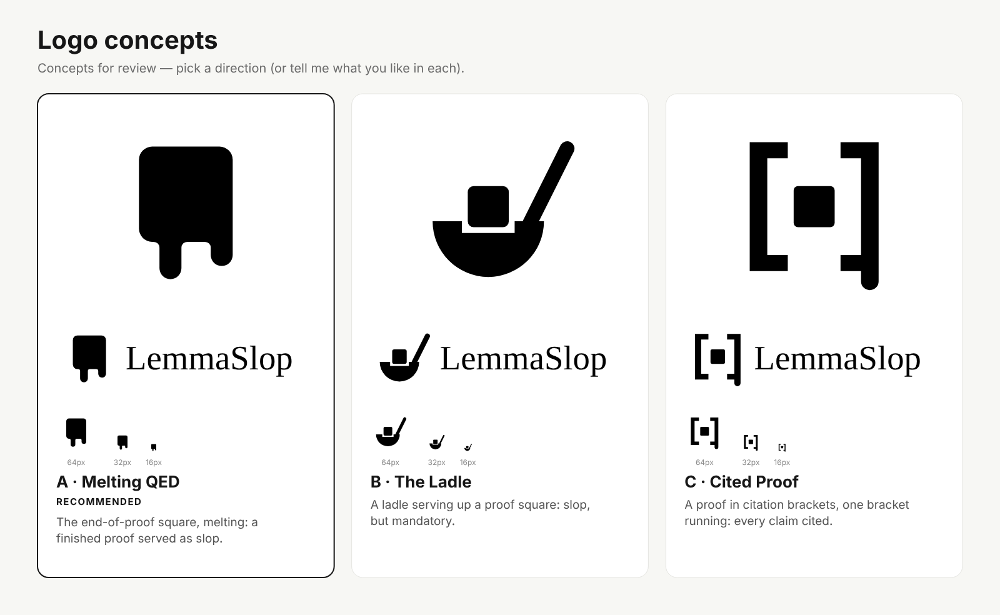

# LemmaSlop logo

Redesigned for the rename from Lemma to LemmaSlop with the [logo-design skill](https://github.com/kaankiziltug/logo-design-skill) (MIT), installed for this project only in `.claude/skills/logo-design/`. The skill's 1,400-logo reference library (third-party trademarks, study only) was left out of the repository; its catalog data is kept so `search_library.py` still works.

## Brief (fast track, assumptions stated)

- **Name:** LemmaSlop. A math notebook that answers from your sources with citations, typeset maths and narrated Manim videos. The name pairs a rigorous word (*lemma*) with a self-aware one (*slop*, what people call AI output).
- **Audience:** university students. **Adjectives:** precise, honest, playful, liquid.
- **Equity audit of the old mark** (a droplet holding the end-of-proof square ∎): keep the ∎ (the strongest maths signifier) and the liquid idea and teal/arctic colours; drop the teardrop silhouette, which the library shows is common.
- **Category clichés avoided:** books, graduation caps, brains, sparkles, neural-network nodes, π and Σ glyphs.

## Concepts

| | Idea | Notes |
|---|---|---|
| **A · Melting QED** (recommended, applied) | The end-of-proof square, melting: a finished proof served as slop. | Keeps the old mark's two assets (∎ and liquid) in one shape. Reads at 16 px as a square with drips. Risk: a dripping shape alone can read as "paint"; the square proportions and the name carry the maths. |
| B · The Ladle | A ladle serving up a proof square: slop, but mandatory. | Funniest and most literal; the handle is thin at 16 px. |
| C · Cited Proof | A proof in citation brackets, one bracket running. | Says "every claim is cited"; risk of reading as a media "stop" button. |

Tested with the skill's scripts: `svg_audit.py` (no issues; 98–99/100), `preview_sheet.py` (`test-sheet.html`: sizes, 16/32 px, one colour, reversed), `concept_sheet.py` (`concepts.png`). An earlier version of A had a falling drop under the long drip; it read as "!" at small sizes and was removed.

## Status

Concept A is applied in the app (`components/icons.tsx` `Mark`, `app/icon.svg` favicon) with the existing ocean-teal / arctic-blue gradient. Per the skill's checkpoint, the full kit (colour palette sheet, one-colour and reversed masters, horizontal and stacked lockups with outlined type, small-size cut, favicon/app-icon set, presentation board, usage guide) is built only once a direction is approved. The lockup here uses live text in Instrument Serif and is for exploration only. Trademark clearance has not been checked.
